<p align="center"></p>

# TOKEN ZOMBIE

**Stop paying for tokens Claude Code wastes.**
Free. Runs on your computer. Nothing is sent anywhere.

[](docs/INSTALL.md) [](SECURITY.md) [](LICENSE)

[Website](https://rishavm713-create.github.io/token-zombie/) · [Install guide](docs/INSTALL.md) · [Docs](#docs) · [Discussions](https://github.com/rishavm713-create/token-zombie/discussions)



## What it does

Long Claude Code chats quietly burn your usage limit on repeated file reads, duplicated sub-agent work and context that fills up and is lost. TOKEN ZOMBIE:

- **Shows** where your tokens go, with every number labelled *measured* or *estimate*.
- **Warns** you before a long chat runs out of room.
- **Saves your place** with a short note, so a fresh chat picks up where you stopped.

It advises and never blocks. Everything stays on your computer. No telemetry, no AI calls in the core.

## Install (one minute)

In Claude Code:

```
/plugin install token-zombie --marketplace rishavm713-create/token-zombie
```

Restart Claude Code, then run:

```
/token-zombie:tz
```

Shell form: `claude plugin install token-zombie --marketplace rishavm713-create/token-zombie`

Verification and a clean rollback are in the [install guide](docs/INSTALL.md).

## How it works

| Step | What happens |
|---|---|
| **Detect** | Flags repeated reads and sub-agents that duplicate or stall. |
| **Contain** | Trims noisy tool output. The original is kept and can be recalled. |
| **Warn** | Tells you early, while there is still time to save the work. |
| **Revive** | A handoff note lets a fresh chat continue without re-explaining. |

A small bar inside Claude Code shows quick signals, and a local dashboard shows the details.


## Honest status

- Claude Code is the supported host. Other tools get experimental rules files only.
- Real before-and-after savings are **not yet measured**, so no savings figure is promised. See [limitations](docs/LIMITATIONS.md) and the [benchmark method](docs/BENCHMARK-METHOD.md).
- Some hook payloads and UI behaviour still need checks on a live host: [implementation matrix](docs/IMPLEMENTATION-MATRIX.md).

## Docs

| Guide | Purpose |
|---|---|
| [Install](docs/INSTALL.md) | Install, verify, roll back |
| [CLI](docs/CLI.md) | Command reference |
| [Modes](docs/MODES.md) | OFF / LITE / FULL / ULTRA |
| [Metrics](docs/METRICS.md) | What each number means and its source |
| [Limitations](docs/LIMITATIONS.md) | Known constraints |
| [Security](SECURITY.md) | Privacy and safety boundaries |
| [Contributing](CONTRIBUTING.md) | First contributions and checks |

## Creator

Built by [Rishav Mishra](https://rishavm713-create.github.io/). Built because the problem was real, and open source so the fix is not another limitation for someone else. Also see [EditSutra](https://editsutra.github.io/).

MIT licence. © 2026 Rishav Mishra.
