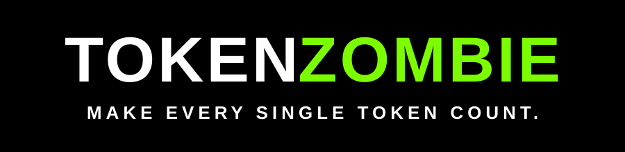
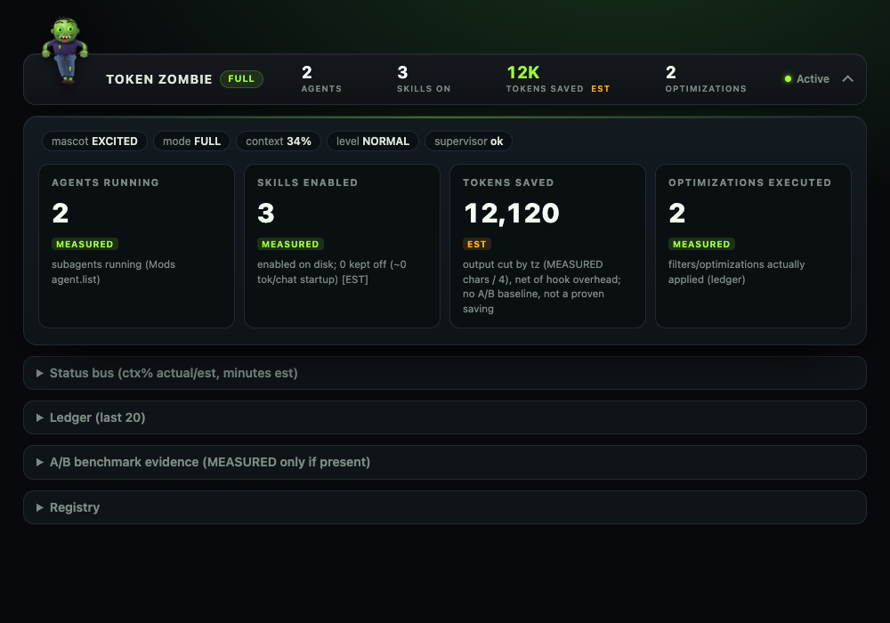
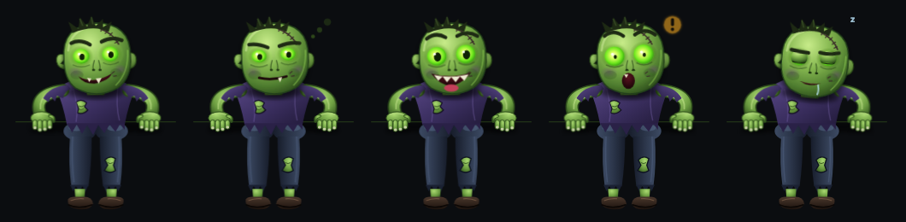
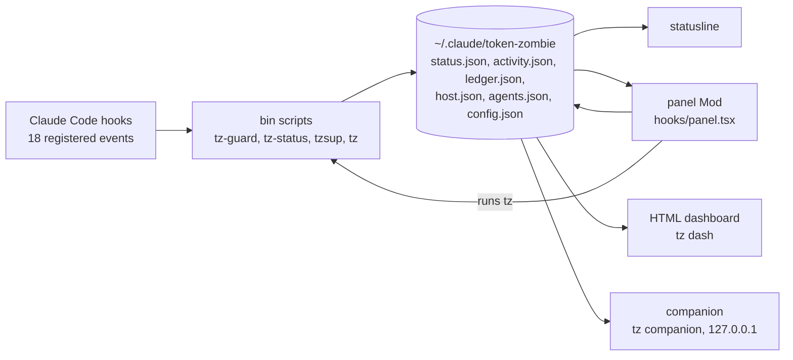

# TOKEN ZOMBIE

<p align="center"></p>

<p align="center">
  <strong>MAKE EVERY SINGLE TOKEN COUNT.</strong><br>
  <em>STOP THE WASTE. CONTROL THE SWARM. PROTECT THE WORKFLOW.</em>
</p>

<p align="center">
  <strong>AI Agent Resource Intelligence for Claude Code</strong><br>
  See what your agents consume. Catch workflow waste. Protect context and continuity.
</p>

<p align="center">
  <a href="#install">Install</a> ·
  <a href="#what-it-is">What it is</a> ·
  <a href="docs/ROADMAP.md">Roadmap</a> ·
  <a href="docs/IMPLEMENTATION-MATRIX.md">Implementation status</a> ·
  <a href="docs/LIMITATIONS.md">Limitations</a>
</p>

<p align="center">
  
  
  
</p>

> **Your AI agents are doing work. Can you see what that work is costing you?**

TOKEN ZOMBIE is a local-first resource-intelligence layer for Claude Code. It observes token and cache activity, tracks agent work, flags inefficient patterns, protects useful context, and helps carry unfinished work into the next session.

It is not just a token counter. It brings **visibility, guardrails, optimisation advice and workflow continuity** into one local control layer.

<p align="center">
  
  <br><sub>Dashboard preview · generated with demo data, not a live user session.</sub>
</p>

## Install

```text
/plugin install token-zombie --marketplace rishavm713-create/token-zombie
```

Restart Claude Code, then run `/token-zombie:tz`. Shell and desktop installation instructions are below.

## What it is

| Capability | What you get |
|---|---|
| **OBSERVE** | A local ledger for hook activity, token/cache estimates, agent activity and resource signals. Values are labelled MEASURED, EST or UNKNOWN. |
| **DETECT** | Evidence-backed advice about repeated reads, large context loads, duplicate or low-value agent work, and rework patterns. |
| **OPTIMISE** | Output trimming in supported paths, reversible recall, Python AST skeleton compression, and optimisation modes. |
| **PROTECT** | Compaction checks, safe-point handoffs, checkpoints and recoverable originals. |
| **CONTINUE** | A compact project state and handoff that helps a fresh chat resume unfinished work. |

The guiding rule: **optimise resource use without pretending that fewer tokens automatically means better work.** Quality and real-world savings still need measured A/B evidence.

## Current status

- **Built in the repository:** 18-event hook ledger, SQLite ledger, agent lifecycle signals, context vault index, handoffs/checkpoints, output trim and recall, Python AST skeleton compression, shadow-mode advice, dashboard and toolbar components.
- **Validation pending:** live-host verification for some hook payloads and UI behaviours; real-world A/B trials have not been recorded.
- **Partial / experimental:** pricing and some cost attribution; some agent intelligence; non-Claude adapters are rules-only and experimental.
- **Not built yet:** semantic/vector memory, non-Python AST compression, task-level vault index and automatic CANARY-to-ACTIVE promotion.

See the [roadmap](docs/ROADMAP.md), [implementation matrix](docs/IMPLEMENTATION-MATRIX.md), [latest code audit](docs/AUDIT.md), [host verification checklist](docs/HOST-VERIFY.md) and [limitations](docs/LIMITATIONS.md). These documents are the source of truth; this README does not turn planned work into shipped features.

## Why it exists

A single small UI change once consumed about 68% of a five-hour usage window. Long chats repeatedly carried history, screenshots stayed in context, agents duplicated work, and there was no single place to understand where resources were going.

TOKEN ZOMBIE grew from that problem: give developers a local view of agent resource use and practical ways to protect the work already done.

It does **not** claim that every warning saves tokens, that every estimate is provider billing data, or that all optimisations preserve quality automatically. The project labels what it knows and documents what it cannot yet prove.

## See it

The repository includes dashboard and mascot captures generated with demo data. They demonstrate the interface, not measured production savings.

<p align="center">
  
  <br><sub>Responsive dashboard preview · demo data.</sub>
</p>

<p align="center">
  
</p>

The in-chat toolbar is part of the product, but a verified public capture of it is not yet included. See [toolbar details](docs/PANEL.md).

## Roadmap

TOKEN ZOMBIE is being developed in stages. The near-term focus is to close verification gaps and publish honest measurements before expanding the feature surface.

- **Now:** verify real-host behaviour, gather real A/B trials, improve measurement coverage and tighten install/onboarding.
- **Next:** improve resource/cost attribution and agent-state intelligence; expand context indexing only where evidence justifies it.
- **Later / planned:** semantic retrieval, broader language-aware compression and deeper task-level orchestration.

The exact status of each item is tracked in the [public roadmap](docs/ROADMAP.md). No planned capability is represented as already shipped.

## Privacy and safety

- Local-first state under `~/.claude/token-zombie/`.
- No network calls or telemetry from the core hooks.
- No model calls inside hooks.
- Advice is non-blocking; TOKEN ZOMBIE does not silently take over the developer's workflow.
- Original output can be recovered with `tz recall` where trimming is supported.
- Local recall files may contain content returned by tools; review local storage before sharing diagnostic files.

Read [SECURITY.md](SECURITY.md) and [LIMITATIONS.md](docs/LIMITATIONS.md).

## Documentation

| Guide | Purpose |
|---|---|
| [Installation](docs/INSTALL.md) | Install, configure, verify and uninstall |
| [Roadmap](docs/ROADMAP.md) | Built, in-progress, planned and deferred capabilities |
| [Implementation matrix](docs/IMPLEMENTATION-MATRIX.md) | Feature-by-feature status |
| [Audit](docs/AUDIT.md) | Evidence-based gap audit |
| [Metrics](docs/METRICS.md) | Metric definitions and labels |
| [Limitations](docs/LIMITATIONS.md) | Known gaps and unverified behaviour |
| [Toolbar / panel](docs/PANEL.md) | In-chat interface |
| [CLI reference](docs/CLI.md) | Commands |
| [Compatibility](COMPAT.md) | Platform and adapter status |
| [Security](SECURITY.md) | Privacy and safety model |
| [Contributing](CONTRIBUTING.md) | Development and contribution guidance |

---

## Architecture


## Optional statusline setup
One step:
```
/plugin install token-zombie --marketplace rishavm713-create/token-zombie
```
Shell form:
```
claude plugin install token-zombie --marketplace rishavm713-create/token-zombie
```
Desktop app: click **+** next to the prompt box > **Plugins** > **Add marketplace** `rishavm713-create/token-zombie` > **Add plugin**.

Optional statusline (also feeds the panel's cost row):
```
bash <plugin dir>/install.sh --statusline-only
```
WARNING: if you used the old `install.sh` hook install, run `install.sh --uninstall` first, or hooks fire twice. More: [docs/INSTALL.md](docs/INSTALL.md).

## Quick start
1. Install the plugin, restart Claude Code.
2. `/token-zombie:tz` for status, or `/tz` if the panel is loaded.
3. `/token-zombie:optimize` to see repeated reads and commands in the current chat.
4. When a chat grows, `/token-zombie:compact` or hand off with `tz handoff`, then start a fresh chat.

## Toolbar
After install, a one-line bar sits above the prompt (Claude Code desktop and terminal):

`[mascot] TOKEN ZOMBIE [FULL]  2 AGENTS  3 SKILLS USED  12K TOKENS SAVED·EST  2 OPTIMIZATIONS  ● Active  ⌄`

| Metric | Counts | Label |
|---|---|---|
| AGENTS | subagents running now (`$.agent.list`) | MEASURED; `—` when unknown |
| SKILLS USED | skills the model invoked this session (Skill tool), from the hook ledger; `tz live skills` lists installed/enabled/discovered/loaded/invoked apart | MEASURED count, dash = UNKNOWN |
| TOKENS SAVED · EST | today since local midnight, all chats: measured savings (rtk, output trims, denied re-reads) net of TZ overhead, plus the fresh-chat counterfactual (split in the panel details) | measured + EST parts; no A/B baseline |
| OPTIMIZATIONS | filter actions that actually ran | MEASURED |

Exact rules and limits: [docs/METRICS.md](docs/METRICS.md).

- **Mascot:** the zombie hangs on the bar's top border. It shows one state, in this priority: alert, excited, working, sleep, idle. On the terminal it is an emoji.
- **Detail pane:** the chevron, or `/tz`, opens it. Its buttons are mode off/lite/full/ultra, Copy, Review, Audit, Board and Compact. Details: [docs/PANEL.md](docs/PANEL.md).

## Commands
Plugin slash commands (namespaced, each runs `tz <sub>`): `/token-zombie:tz`, `optimize`, `audit`, `review`, `compact`, `board`, `supervisor`, `benchmark`. The panel Mod also registers a bare `/tz` (no model call). `compact` cannot run `/compact` itself; it refreshes the handoff and tells you to type it.

`tz` CLI subcommands (`tz help` is authoritative): status, forecast, startup, optimize, filter, classify, stats, handoff, task-wrap, checkpoint, resume, skills, capabilities, security, audit, instructions, profile, bench, config, report, sup, route, adapters, reg, dash, companion, mascot, overlay, mode. Exit codes: 0 ok; 1 failure or RED/no state; 2 usage; 3 `status` in STOP state. Reference: [skills/token-zombie/references/commands.md](skills/token-zombie/references/commands.md), [docs/CLI.md](docs/CLI.md).

## Modes
`tz mode <off|lite|full|ultra>` (default `full`). Safety controls stay on in every mode. Table and precedence: [docs/MODES.md](docs/MODES.md).

## UI captures
All captures use DEMO data in a throwaway HOME, not a real session.

Dashboard (demo data):


Dashboard, phone width (demo data):


Mascot states idle / working / excited / alert / sleep (animation paused):


In-chat toolbar: no capture published yet. Details: [docs/PANEL.md](docs/PANEL.md).

## Configuration
`~/.claude/token-zombie/config.json`, same keys as `tz config` (env `TZ_<KEY>` beats the file beats the mode profile beats defaults):

| key | default | meaning |
|---|---|---|
| `mode` | `full` | off, lite, full, ultra |
| `limit` | 100000 | tokens of growth after the first reply: suggest a fresh session for the next task |
| `hard` | 175000 | tokens: hand the rest of the task to a fresh session at a safe point |
| `read_warn` | 40000 | bytes: first whole Read of a bigger file gets a targeted-read nudge once |
| `plan_warn` / `plan_stop` | 90 / 97 | plan-usage % (only from real provider data) |
| `startup_warn` | 60000 | tokens: warn when a new chat loads more than this |
| `ctx_window` | 200000 | ESTIMATE of the model context window (logs do not state it) |

Template: `config.example.json`.

## Metrics honesty
Every number is labelled **MEASURED** (real file or host event), **EST** (estimate with a stated basis) or **UNKNOWN** (no data). The ledger counts only output tz actually cut (chars / 4), net of its own hook overhead. There is no with/without A/B baseline yet, so no savings figure here is a proven saving. See [docs/METRICS.md](docs/METRICS.md) and [docs/LIMITATIONS.md](docs/LIMITATIONS.md).

## Security and privacy
No network calls, no telemetry. `dash --serve` and `companion` bind 127.0.0.1 only, need a token and a Host-header check. `errors.log` is redacted. `tz` never edits skills, plugins, MCP or settings; only `install.sh` touches `settings.json` (backup, dry-run, restore). Details and reporting: [SECURITY.md](SECURITY.md).

## Troubleshooting
- Hooks fire twice: legacy `install.sh` hooks plus the plugin. Run `install.sh --uninstall`.
- Panel cost shows `n/a (statusline not wired)`: run `install.sh --statusline-only`.
- Panel rows say `no data` or `(stale)`: `status.json` is missing or older than 10 minutes; send a prompt so the supervisor ticks.
- Activity shows UNKNOWN: no hook event seen (hooks not loaded) or none for 15 minutes while working.
- Check state: `tz config`, `tz sup status`, `bash install.sh --check`.
- Errors land in `~/.claude/token-zombie/errors.log` (redacted).

## Uninstall and recovery
- `/plugin uninstall token-zombie`
- Legacy install: `bash install.sh --uninstall` (removes hooks, restores your previous statusline) or `--restore` (newest `settings.json.bak-tz-*`).
- Silence advice: `tz mode off` (safety controls stay on). Disable the supervisor: env `TZ_SUP=0`.
- Corrupt state files are quarantined as `*.corrupt`, `*.corrupt.1`, ... and never overwritten; delete them when done.

## Compatibility
Claude Code >= 2.1.318 tested. macOS tested; Linux expected via CI; Windows untested. Non-Claude adapters (Codex, Cursor, Windsurf, Gemini, Cline, Roo, Antigravity) are EXPERIMENTAL, rules-only (no hooks, no statusline): see [COMPAT.md](COMPAT.md).

## Tests
`bash tests/run_all.sh` (fake HOME; real settings are never written). See [CONTRIBUTING.md](CONTRIBUTING.md), [CHANGELOG.md](CHANGELOG.md).

## License
MIT, see [LICENSE](LICENSE).
