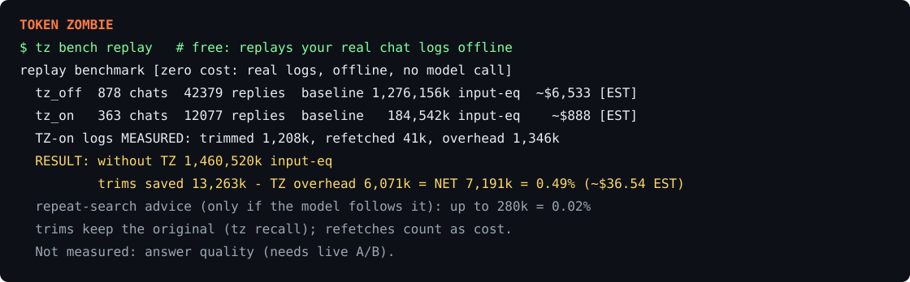

<p align="center"><picture><source media="(prefers-color-scheme: light)" srcset="docs/img/logo-light.svg"></picture></p>

<h1 align="center">TOKEN ZOMBIE</h1>

<p align="center"><b>Stop paying for tokens Claude Code wastes.</b><br>Free · Runs on your computer · Nothing is sent anywhere</p>

[](https://github.com/rishavm713-create/token-zombie/actions/workflows/ci.yml) [](LICENSE) [](SECURITY.md)



TOKEN ZOMBIE (TZ) trims noisy tool output, warns before a chat runs out of room, and saves handoffs so a fresh chat continues where you stopped. It adds no AI calls of its own.

## Install

```bash
claude plugin marketplace add rishavm713-create/token-zombie
claude plugin install token-zombie@token-zombie
```

Restart Claude Code, then run `/token-zombie:tz`. Or `npm i -g token-zombie` for the `tz` CLI alone (needs python3). Verify and roll back: [install guide](docs/INSTALL.md).

## You do not type these

Once the hooks are registered (plugin install, or `./install.sh` for the CLI), these run by themselves. `tz hooks live` shows whether they fire. Each can be switched with `TZ_FEAT_<NAME>=0/1` or `features` in config.json; `mode off` turns all of them off.

**On by default (advice and recording, no blocking):** 1 h vs 5 min cache-life detection (`cache_ttl_auto`), idle-past-cache cost (`idle_cost`), unrelated task, big paste, home-folder start and many short prompts (`task_switch`, `paste_warn`, `home_cwd`, `small_msgs`), model and plan advice (`model_advice`, `plan_advice`), oversized instruction files (`instr_advice`), repeat reads with a file skeleton (`dup_skeleton`), repeat read-only MCP calls (`mcp_dedup`), stuck patterns (`stuck_detect`), destructive-command and secret-path checks (`safety_net`), build/test log trimming that keeps every failure line (`log_compress`), SKILL.md spec lint (`skill_lint`), test output piped through head/tail (`check_pipe`), curl/wget to a host outside `.tz/scope.json` (`scope_check`), budget level warnings once a budget is set (`budget_warn`), stale-branch warning before a broad test run (`stale_warn`), parallel sessions for independent tasks (`auto_split`, `ship_fast`).

**Opt-in (default off, they block, add context or record):** `size_gate`, `size_cap`, `paste_block`, `bulk_read_block`, `read_delta`, `git_guard`, `safety_extra`, `safety_strict`, `custom_rules`, `budget_block`, `stale_block`, `plan_reinject`, `beads_prime`, `micro_skills`, `unverified_claim`, `rtk_filters`, `learn_loop`, `crash_restart`, `defaults_advice`, `obs_record`, `obs_file_context`, `obs_inject`, `line_custom_command`.

## Commands

Everything below also works on demand. You only need these when you want the detail.

| Group | Commands | Use |
|---|---|---|
| Status | `tz status` `forecast` `stats` | Context, burn, savings (MEASURED / EST / UNKNOWN) |
| Handoff | `tz handoff` `resume` `recall` | Save, continue, restore trimmed output |
| Budget | `tz budget` `ccusage` `stale` `claim` | Budgets, usage cross-check, stale branches, session notes |
| Safety | `tz gitguard` `rules` `scope` `sandbox` `scrub` | Git safety, rulebooks, allowed hosts, bounded run, secret scrub |
| Output | `tz logc` `delta` `skill-lint` `planphase` | Log trimming, re-read diff, SKILL.md lint, plan-first check |
| Search | `tz sg` `memsearch` `sym` `impact` `replayrank` | Structural search, note search, symbols, callers, replay ranking |
| Record | `tz obs` `trace` `ts` `facts` `debt` | Observations, token trace, tags, project facts, shortcut ledger |
| Parallel | `tz squad` `team` `tbench` `spec` | Parallel tasks, multi-worker run, benchmarks, specs |
| Other | `tz clihelp` `depth` `condense` `diag` `fast` `line` | CLI listing, depth advice, history condense, post-edit check, profiling, status line |

One line per command: [docs/COMMANDS.md](docs/COMMANDS.md). Every `tz` subcommand: `tz help`.

CI: the badge above is live. The Windows CI job is known to fail and is deferred; macOS and Linux are the supported platforms.

## Safety

Local only, no telemetry. Destructive commands are caught and checkpoints allow rollback. Details: [SECURITY.md](SECURITY.md).

## More

[Overview](docs/OVERVIEW.md) · [Install](docs/INSTALL.md) · [CLI](docs/CLI.md) · [Modes](docs/MODES.md) · [Metrics](docs/METRICS.md) · [Benchmark method](docs/BENCHMARK-METHOD.md) · [Limitations](docs/LIMITATIONS.md) · [Contributing](CONTRIBUTING.md) · [Brand policy](BRANDING.md) · [Website](https://rishavm713-create.github.io/token-zombie/) · [Discussions](https://github.com/rishavm713-create/token-zombie/discussions)

Created by [Rishav Mishra](https://rishavm713-create.github.io/). Copyright © 2026 Rishav Mishra. [MIT licence](LICENSE); credits: [NOTICE](NOTICE).
