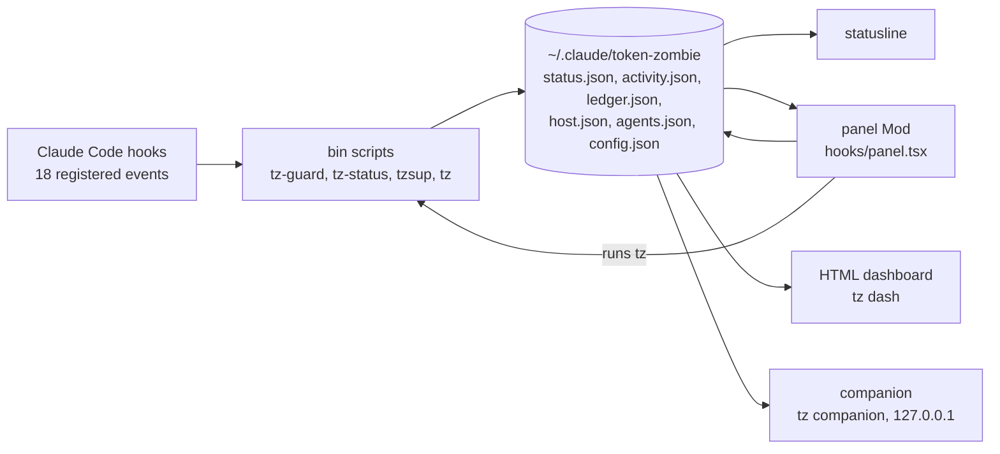

<div align="center">


# MAKE EVERY SINGLE TOKEN COUNT.

### AI AGENT RESOURCE INTELLIGENCE FOR CLAUDE CODE

**STOP THE WASTE. CONTROL THE SWARM. PROTECT THE WORKFLOW.**

[**Install TOKEN ZOMBIE →**](#-get-started) · [Explore the capabilities](#-the-control-layer) · [Roadmap](docs/ROADMAP.md) · [Engineering audit](docs/AUDIT.md)


</div>

> **Your agents are doing work. TOKEN ZOMBIE helps you see the resource use, spot wasteful patterns and protect the work that matters.**

<table>
<tr>
<td width="50%" valign="top">

### ☣ RESOURCE INTELLIGENCE
Track token and cache signals, usage ledgers, cost estimates and hook overhead. Every value is labelled **MEASURED**, **EST** or **UNKNOWN**.

</td>
<td width="50%" valign="top">

### 🧠 AGENT INTELLIGENCE
Track agent lifecycle, ROI flags, duplicate or empty work, estimated stalls, retries and repeated edits.

</td>
</tr>
<tr>
<td width="50%" valign="top">

### ⚡ CONTEXT OPTIMISATION
Large-read nudges, repeated-read detection, supported output trimming, reversible recall, Python AST skeletons and shadow mode.

</td>
<td width="50%" valign="top">

### 🛡 WORKFLOW SURVIVAL
Compaction checks, project state, checkpoints, handoffs, resume verification and supervisor signals.

</td>
</tr>
<tr>
<td width="50%" valign="top">

### 🎛 DEVELOPER CONTROL SURFACE
In-chat toolbar, expandable pane, four headline metrics, mode controls, dashboard, statusline and CLI.

</td>
<td width="50%" valign="top">

### 🔒 LOCAL-FIRST BY DESIGN
No telemetry, no network calls or model calls inside core hooks. Advice is non-blocking; supported trims preserve originals for recall.

</td>
</tr>
</table>

<div align="center">


<sub>Dashboard preview · generated with demo data. It is an interface illustration, not a live-session benchmark.</sub>

</div>

## ⚡ Get started

```text
/plugin install token-zombie --marketplace rishavm713-create/token-zombie
```

Restart Claude Code, then run:

```text
/token-zombie:tz
```

[Full installation guide →](docs/INSTALL.md)

## 🧩 The control layer

<div align="center">

| OBSERVE | DETECT | OPTIMISE | PROTECT | CONTINUE |
|:---:|:---:|:---:|:---:|:---:|
| Resource signals | Workflow waste | Context & output | Safe handoffs | Project state |
| Ledger & cache | Agent patterns | Reversible trims | Checkpoints | Resume |

</div>

| System | Capabilities in the repository |
|---|---|
| **Resource accounting** | 5m / 1h cache split, thinking-token estimate, incremental transcript scan, SQLite ledger, usage labels, reports and hook-overhead benchmark |
| **Agent intelligence** | Agent start/stop/ID lifecycle, ROI flags, duplicate/small/empty/failed/stalled signals, skill-state discovery and rework counts |
| **Context intelligence** | Large-read nudges, repeated-read advice, output trimming, recall, Python AST skeleton compression, keyword retrieval and Context Vault index |
| **Continuity & survival** | `STATE.md`, handoffs, checkpoints, resume verification, compaction survival checks, supervisor status and next-session brief |
| **Control surface** | In-chat toolbar, detail pane, OFF/LITE/FULL/ULTRA modes, dashboard, terminal statusline, local companion, mascot states and CLI |

## 🖥 See the product

<div align="center">

<br><sub>Responsive dashboard · demo data.</sub>
</div>

<div align="center">

<br><sub>Idle · Working · Excited · Alert · Sleep</sub>
</div>

The in-chat toolbar is implemented, but a verified public capture of the live toolbar is not published yet. [See its documented behaviour](docs/PANEL.md).

## 🚦 Implementation status

| <span>IN THE REPOSITORY</span> | <span>VALIDATION REQUIRED</span> | <span>NOT BUILT YET</span> |
|---|---|---|
| Hook ledger, SQLite ledger, handoffs, checkpoints, supported output trim + recall, Python AST skeleton, dashboard and toolbar components | Real-host checks for some hook payloads and UI behaviour; real A/B savings trials | Semantic/vector memory, non-Python AST compression, task-level vault index, automatic CANARY → ACTIVE |

**Important:** implementation and test coverage do not mean every feature has been verified on a live host. Savings are not proven end-to-end: no real with/without A/B trials are recorded yet. Other adapters are experimental rules-file outputs; Claude Code is the supported integration.

[Full roadmap](docs/ROADMAP.md) · [Implementation matrix](docs/IMPLEMENTATION-MATRIX.md) · [Audit](docs/AUDIT.md) · [Limitations](docs/LIMITATIONS.md)

## 🔐 Privacy & safety

- Local state under `~/.claude/token-zombie/`.
- No network calls or telemetry from core hooks.
- No model calls inside hooks.
- Advice is non-blocking; the developer stays in control.
- Supported output trims retain originals for `tz recall`.
- Local recall may contain tool output; review it before sharing diagnostics.

[Security model](SECURITY.md) · [Metrics definitions](docs/METRICS.md)

## 📚 Documentation

| Guide | What it covers |
|---|---|
| [Installation](docs/INSTALL.md) | Setup, optional statusline, rollback |
| [Roadmap](docs/ROADMAP.md) | Built, validation, planned and deferred |
| [Toolbar & panel](docs/PANEL.md) | In-chat control surface |
| [Metrics](docs/METRICS.md) | Data sources, formulas and limits |
| [CLI](docs/CLI.md) | Commands |
| [Compatibility](COMPAT.md) | Supported and experimental integrations |
| [Contributing](CONTRIBUTING.md) | Development and contributions |

---

## Architecture


## Optional statusline setup
One step:
```
/plugin install token-zombie --marketplace rishavm713-create/token-zombie
```
Shell form:
```
claude plugin install token-zombie --marketplace rishavm713-create/token-zombie
```
Desktop app: click **+** next to the prompt box > **Plugins** > **Add marketplace** `rishavm713-create/token-zombie` > **Add plugin**.

Optional statusline (also feeds the panel's cost row):
```
bash <plugin dir>/install.sh --statusline-only
```
WARNING: if you used the old `install.sh` hook install, run `install.sh --uninstall` first, or hooks fire twice. More: [docs/INSTALL.md](docs/INSTALL.md).

## Quick start
1. Install the plugin, restart Claude Code.
2. `/token-zombie:tz` for status, or `/tz` if the panel is loaded.
3. `/token-zombie:optimize` to see repeated reads and commands in the current chat.
4. When a chat grows, `/token-zombie:compact` or hand off with `tz handoff`, then start a fresh chat.

## Toolbar
After install, a one-line bar sits above the prompt (Claude Code desktop and terminal):

`[mascot] TOKEN ZOMBIE [FULL]  2 AGENTS  3 SKILLS USED  12K TOKENS SAVED·EST  2 OPTIMIZATIONS  ● Active  ⌄`

| Metric | Counts | Label |
|---|---|---|
| AGENTS | subagents running now (`$.agent.list`) | MEASURED; `—` when unknown |
| SKILLS USED | skills the model invoked this session (Skill tool), from the hook ledger; `tz live skills` lists installed/enabled/discovered/loaded/invoked apart | MEASURED count, dash = UNKNOWN |
| TOKENS SAVED · EST | today since local midnight, all chats: measured savings (rtk, output trims, denied re-reads) net of TZ overhead, plus the fresh-chat counterfactual (split in the panel details) | measured + EST parts; no A/B baseline |
| OPTIMIZATIONS | filter actions that actually ran | MEASURED |

Exact rules and limits: [docs/METRICS.md](docs/METRICS.md).

- **Mascot:** the zombie hangs on the bar's top border. It shows one state, in this priority: alert, excited, working, sleep, idle. On the terminal it is an emoji.
- **Detail pane:** the chevron, or `/tz`, opens it. Its buttons are mode off/lite/full/ultra, Copy, Review, Audit, Board and Compact. Details: [docs/PANEL.md](docs/PANEL.md).

## Commands
Plugin slash commands (namespaced, each runs `tz <sub>`): `/token-zombie:tz`, `optimize`, `audit`, `review`, `compact`, `board`, `supervisor`, `benchmark`. The panel Mod also registers a bare `/tz` (no model call). `compact` cannot run `/compact` itself; it refreshes the handoff and tells you to type it.

`tz` CLI subcommands (`tz help` is authoritative): status, forecast, startup, optimize, filter, classify, stats, handoff, task-wrap, checkpoint, resume, skills, capabilities, security, audit, instructions, profile, bench, config, report, sup, route, adapters, reg, dash, companion, mascot, overlay, mode. Exit codes: 0 ok; 1 failure or RED/no state; 2 usage; 3 `status` in STOP state. Reference: [skills/token-zombie/references/commands.md](skills/token-zombie/references/commands.md), [docs/CLI.md](docs/CLI.md).

## Modes
`tz mode <off|lite|full|ultra>` (default `full`). Safety controls stay on in every mode. Table and precedence: [docs/MODES.md](docs/MODES.md).

## UI captures
All captures use DEMO data in a throwaway HOME, not a real session.

Dashboard (demo data):


Dashboard, phone width (demo data):


Mascot states idle / working / excited / alert / sleep (animation paused):


In-chat toolbar: no capture published yet. Details: [docs/PANEL.md](docs/PANEL.md).

## Configuration
`~/.claude/token-zombie/config.json`, same keys as `tz config` (env `TZ_<KEY>` beats the file beats the mode profile beats defaults):

| key | default | meaning |
|---|---|---|
| `mode` | `full` | off, lite, full, ultra |
| `limit` | 100000 | tokens of growth after the first reply: suggest a fresh session for the next task |
| `hard` | 175000 | tokens: hand the rest of the task to a fresh session at a safe point |
| `read_warn` | 40000 | bytes: first whole Read of a bigger file gets a targeted-read nudge once |
| `plan_warn` / `plan_stop` | 90 / 97 | plan-usage % (only from real provider data) |
| `startup_warn` | 60000 | tokens: warn when a new chat loads more than this |
| `ctx_window` | 200000 | ESTIMATE of the model context window (logs do not state it) |

Template: `config.example.json`.

## Metrics honesty
Every number is labelled **MEASURED** (real file or host event), **EST** (estimate with a stated basis) or **UNKNOWN** (no data). The ledger counts only output tz actually cut (chars / 4), net of its own hook overhead. There is no with/without A/B baseline yet, so no savings figure here is a proven saving. See [docs/METRICS.md](docs/METRICS.md) and [docs/LIMITATIONS.md](docs/LIMITATIONS.md).

## Security and privacy
No network calls, no telemetry. `dash --serve` and `companion` bind 127.0.0.1 only, need a token and a Host-header check. `errors.log` is redacted. `tz` never edits skills, plugins, MCP or settings; only `install.sh` touches `settings.json` (backup, dry-run, restore). Details and reporting: [SECURITY.md](SECURITY.md).

## Troubleshooting
- Hooks fire twice: legacy `install.sh` hooks plus the plugin. Run `install.sh --uninstall`.
- Panel cost shows `n/a (statusline not wired)`: run `install.sh --statusline-only`.
- Panel rows say `no data` or `(stale)`: `status.json` is missing or older than 10 minutes; send a prompt so the supervisor ticks.
- Activity shows UNKNOWN: no hook event seen (hooks not loaded) or none for 15 minutes while working.
- Check state: `tz config`, `tz sup status`, `bash install.sh --check`.
- Errors land in `~/.claude/token-zombie/errors.log` (redacted).

## Uninstall and recovery
- `/plugin uninstall token-zombie`
- Legacy install: `bash install.sh --uninstall` (removes hooks, restores your previous statusline) or `--restore` (newest `settings.json.bak-tz-*`).
- Silence advice: `tz mode off` (safety controls stay on). Disable the supervisor: env `TZ_SUP=0`.
- Corrupt state files are quarantined as `*.corrupt`, `*.corrupt.1`, ... and never overwritten; delete them when done.

## Compatibility
Claude Code >= 2.1.318 tested. macOS tested; Linux expected via CI; Windows untested. Non-Claude adapters (Codex, Cursor, Windsurf, Gemini, Cline, Roo, Antigravity) are EXPERIMENTAL, rules-only (no hooks, no statusline): see [COMPAT.md](COMPAT.md).

## Tests
`bash tests/run_all.sh` (fake HOME; real settings are never written). See [CONTRIBUTING.md](CONTRIBUTING.md), [CHANGELOG.md](CHANGELOG.md).

## License
MIT, see [LICENSE](LICENSE).
