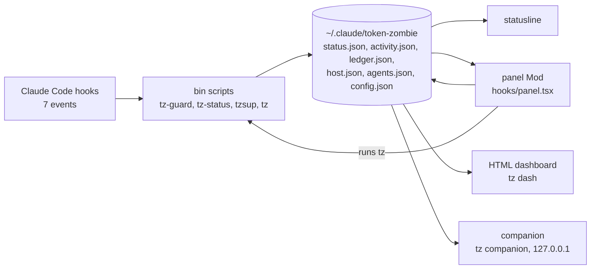
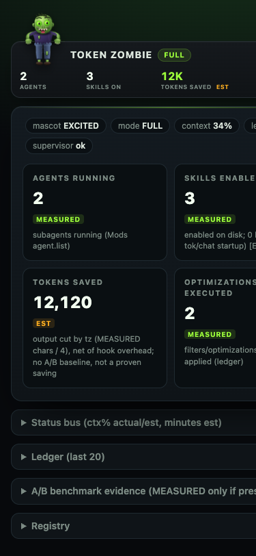

# TOKEN ZOMBIE

<p align="center"></p>

**MAKE EVERY SINGLE TOKEN COUNT.**

Local-first token saver for Claude Code. It watches chat size and plan usage, nudges you to hand off before a chat gets expensive, and audits what loads into every chat. No network, no telemetry; nothing leaves your machine.

## Why it exists
The same task, equal quality, fewer resources. TOKEN ZOMBIE was built after one small UI change burned about 68% of a 5-hour limit: a chat past 100k tokens re-sent its whole history on every step, screenshots stayed in context, agents duplicated work, and nothing showed where the tokens went.

It is not only a token saver. The aim is one local layer that watches, protects and continues the work, so you need fewer separate plugins, skills and agent stacks to get the same result:
- **See** where tokens, cache writes (5m / 1h), agents and cost go, with every number labelled MEASURED, EST or UNAVAILABLE. No invented metrics.
- **Protect** quality: compaction survival check, output trims run in shadow mode first, originals always recoverable (`tz recall`).
- **Control** agents: exact lifecycle by agent id, duplicate / small / empty / stalled agent flags, cost per agent.
- **Continue** unfinished work across chats (`handoffs/STATE.md`, `tz resume`) instead of rebuilding context.
- **Local only**: no network, no telemetry, no model calls inside hooks. Advice never blocks you.

Honest status: see [docs/IMPLEMENTATION-MATRIX.md](docs/IMPLEMENTATION-MATRIX.md) and [docs/LEFT.md](docs/LEFT.md) for what is built, partial or not built. Replacing other plugins and skills is the direction, not a measured claim.

## Built vs roadmap
**Built and tested (live features):** hook ledger on 18 events, agent lifecycle + ROI flags, compaction survival check, 5m/1h cache split, thinking-token EST, incremental transcript scan, Ledger/Priced/Mixed/Unpriced labels, one SQLite ledger (`tz ledger`), alerts with evidence, intervention and outcome, Context Vault index (`tz ledger --vault`), AST skeleton for Python files (`tz compress`, validated, fail open), shadow-mode output trim, recall search.

**Roadmap, NOT built yet:** vector/semantic memory, AST compression for languages other than Python, a task-level vault index (today: by session, tool and file), automatic promotion CANARY to ACTIVE (today: advice only), host-verified PostCompact data (needs a real host run after `install.sh`).

What is in it:
- **Guard hooks** on 18 events (UserPromptSubmit, PostToolUse, PreToolUse, SessionStart, PreCompact, PostCompact, Stop, SessionEnd, SubagentStart/Stop, InstructionsLoaded, PostToolUseFailure, PostToolBatch, Pre/PostModelSwitch, WorktreeCreate/Remove, FileChanged): size warnings, big-Read and duplicate-read advice. Advice never blocks.
- **Supervisor** (`tz sup`): usage level, auto checkpoint, status bus (`status.json`), next-session brief.
- **Handoffs and checkpoints**: `tz handoff` / `tz resume` / `tz checkpoint` keep task state across chats and verify it against git and tests.
- **Context continuity**: `tz state` keeps one compact `handoffs/STATE.md` (master facts, current work, session handoff; a section is rewritten only when its facts change). `tz expensive` reads real usage and repeated reads, saves a verified checkpoint and prints the manual fresh-chat step (the desktop app cannot switch chats for you). `tz waste-audit` finds duplicated handoff docs, repeated reads and long pasted briefs.
- **Optimizer**: repeated reads and commands, output filter, task classification and model advice, savings ledger net of tz's own overhead.
- **Skill / plugin / MCP audit**: inventory, overlaps, GREEN/YELLOW/RED static scan.
- **Modes**: off, lite, full, ultra.
- **Toolbar Mod**: a slim bar above the prompt with the mascot, the mode, and four metrics. A chevron (or `/tz`) opens the detail pane: live tokens, agent time, cost, context, supervisor, and mode buttons.
- **HTML dashboard** (`tz dash`): the same bar plus metric cards, and an SVG zombie mascot.

## Architecture


## Install
One step:
```
/plugin install token-zombie --marketplace rishavm713-create/token-zombie
```
Shell form:
```
claude plugin install token-zombie --marketplace rishavm713-create/token-zombie
```
Desktop app: click **+** next to the prompt box > **Plugins** > **Add marketplace** `rishavm713-create/token-zombie` > **Add plugin**.

Optional statusline (also feeds the panel's cost row):
```
bash <plugin dir>/install.sh --statusline-only
```
WARNING: if you used the old `install.sh` hook install, run `install.sh --uninstall` first, or hooks fire twice. More: [docs/INSTALL.md](docs/INSTALL.md).

## Quick start
1. Install the plugin, restart Claude Code.
2. `/token-zombie:tz` for status, or `/tz` if the panel is loaded.
3. `/token-zombie:optimize` to see repeated reads and commands in the current chat.
4. When a chat grows, `/token-zombie:compact` or hand off with `tz handoff`, then start a fresh chat.

## Toolbar
After install, a one-line bar sits above the prompt (Claude Code desktop and terminal):

`[mascot] TOKEN ZOMBIE [FULL]  2 AGENTS  3 SKILLS USED  12K TOKENS SAVED·EST  2 OPTIMIZATIONS  ● Active  ⌄`

| Metric | Counts | Label |
|---|---|---|
| AGENTS | subagents running now (`$.agent.list`) | MEASURED; `—` when unknown |
| SKILLS USED | skills the model invoked this session (Skill tool), from the hook ledger; `tz live skills` lists installed/enabled/discovered/loaded/invoked apart | MEASURED count, dash = UNKNOWN |
| TOKENS SAVED · EST | today since local midnight, all chats: measured savings (rtk, output trims, denied re-reads) net of TZ overhead, plus the fresh-chat counterfactual (split in the panel details) | measured + EST parts; no A/B baseline |
| OPTIMIZATIONS | filter actions that actually ran | MEASURED |

Exact rules and limits: [docs/METRICS.md](docs/METRICS.md).

- **Mascot:** the zombie hangs on the bar's top border. It shows one state, in this priority: alert, excited, working, sleep, idle. On the terminal it is an emoji.
- **Detail pane:** the chevron, or `/tz`, opens it. Its buttons are mode off/lite/full/ultra, Copy, Review, Audit, Board and Compact. Details: [docs/PANEL.md](docs/PANEL.md).

## Commands
Plugin slash commands (namespaced, each runs `tz <sub>`): `/token-zombie:tz`, `optimize`, `audit`, `review`, `compact`, `board`, `supervisor`, `benchmark`. The panel Mod also registers a bare `/tz` (no model call). `compact` cannot run `/compact` itself; it refreshes the handoff and tells you to type it.

`tz` CLI subcommands (`tz help` is authoritative): status, forecast, startup, optimize, filter, classify, stats, handoff, task-wrap, checkpoint, resume, skills, capabilities, security, audit, instructions, profile, bench, config, report, sup, route, adapters, reg, dash, companion, mascot, overlay, mode. Exit codes: 0 ok; 1 failure or RED/no state; 2 usage; 3 `status` in STOP state. Reference: [skills/token-zombie/references/commands.md](skills/token-zombie/references/commands.md), [docs/CLI.md](docs/CLI.md).

## Modes
`tz mode <off|lite|full|ultra>` (default `full`). Safety controls stay on in every mode. Table and precedence: [docs/MODES.md](docs/MODES.md).

## UI captures
All captures use DEMO data in a throwaway HOME, not a real session.

Dashboard (demo data):


Dashboard, phone width (demo data):



Mascot states idle / working / excited / alert / sleep (animation paused):


In-chat toolbar: no capture published yet. Details: [docs/PANEL.md](docs/PANEL.md).

## Configuration
`~/.claude/token-zombie/config.json`, same keys as `tz config` (env `TZ_<KEY>` beats the file beats the mode profile beats defaults):

| key | default | meaning |
|---|---|---|
| `mode` | `full` | off, lite, full, ultra |
| `limit` | 100000 | tokens of growth after the first reply: suggest a fresh session for the next task |
| `hard` | 175000 | tokens: hand the rest of the task to a fresh session at a safe point |
| `read_warn` | 40000 | bytes: first whole Read of a bigger file gets a targeted-read nudge once |
| `plan_warn` / `plan_stop` | 90 / 97 | plan-usage % (only from real provider data) |
| `startup_warn` | 60000 | tokens: warn when a new chat loads more than this |
| `ctx_window` | 200000 | ESTIMATE of the model context window (logs do not state it) |

Template: `config.example.json`.

## Metrics honesty
Every number is labelled **MEASURED** (real file or host event), **EST** (estimate with a stated basis) or **UNKNOWN** (no data). The ledger counts only output tz actually cut (chars / 4), net of its own hook overhead. There is no with/without A/B baseline yet, so no savings figure here is a proven saving. See [docs/METRICS.md](docs/METRICS.md) and [docs/LIMITATIONS.md](docs/LIMITATIONS.md).

## Security and privacy
No network calls, no telemetry. `dash --serve` and `companion` bind 127.0.0.1 only, need a token and a Host-header check. `errors.log` is redacted. `tz` never edits skills, plugins, MCP or settings; only `install.sh` touches `settings.json` (backup, dry-run, restore). Details and reporting: [SECURITY.md](SECURITY.md).

## Troubleshooting
- Hooks fire twice: legacy `install.sh` hooks plus the plugin. Run `install.sh --uninstall`.
- Panel cost shows `n/a (statusline not wired)`: run `install.sh --statusline-only`.
- Panel rows say `no data` or `(stale)`: `status.json` is missing or older than 10 minutes; send a prompt so the supervisor ticks.
- Activity shows UNKNOWN: no hook event seen (hooks not loaded) or none for 15 minutes while working.
- Check state: `tz config`, `tz sup status`, `bash install.sh --check`.
- Errors land in `~/.claude/token-zombie/errors.log` (redacted).

## Uninstall and recovery
- `/plugin uninstall token-zombie`
- Legacy install: `bash install.sh --uninstall` (removes hooks, restores your previous statusline) or `--restore` (newest `settings.json.bak-tz-*`).
- Silence advice: `tz mode off` (safety controls stay on). Disable the supervisor: env `TZ_SUP=0`.
- Corrupt state files are quarantined as `*.corrupt`, `*.corrupt.1`, ... and never overwritten; delete them when done.

## Compatibility
Claude Code >= 2.1.318 tested. macOS tested; Linux expected via CI; Windows untested. Non-Claude adapters (Codex, Cursor, Windsurf, Gemini, Cline, Roo, Antigravity) are EXPERIMENTAL, rules-only (no hooks, no statusline): see [COMPAT.md](COMPAT.md).

## Tests
`bash tests/run_all.sh` (fake HOME; real settings are never written). See [CONTRIBUTING.md](CONTRIBUTING.md), [CHANGELOG.md](CHANGELOG.md).

## License
MIT, see [LICENSE](LICENSE).
